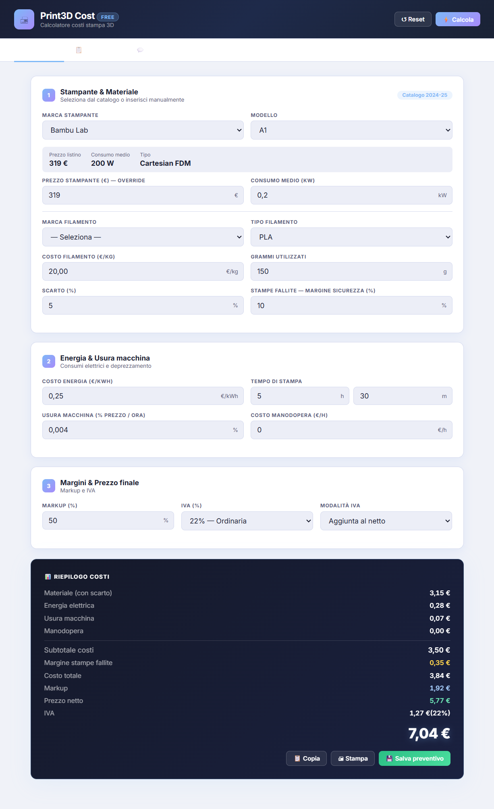

[README (1).md](https://github.com/user-attachments/files/35216604/README.1.md)
<div align="center">
  
  <h1>Print3D Cost — Free</h1>
  <p><strong>All-in-one 3D printing cost calculator and quote generator.</strong></p>
  <!-- Inserisci qui i badge e i link della live demo -->
</div>


  # Print3D Cost — Free
  
  **All-in-one 3D printing cost calculator and quote generator: calculate exact production costs, factor in machine wear and failure margins, and export professional quotes in seconds.**

  [](LICENSE)
  [](https://github.com/AlessioR90/Print-Market-Management/releases)
  []()
  [-brightgreen.svg)]()

  [Live Demo](https://alessior90.github.io/Print-Market-Management/) • 
  [Report Bug](https://github.com/AlessioR90/Print-Market-Management/issues) • 
  [Request Feature](https://github.com/AlessioR90/Print-Market-Management/issues)

</div>

---

<!-- Inserisci qui uno screenshot o una GIF dell'interfaccia di Print3D Cost -->
<div align="center">
  
</div>

## 🎯 Why Print3D Cost?

Pricing 3D prints accurately is tough. Hidden expenses like electricity, filament waste, failed prints, and hardware depreciation easily eat into your profits. **Print3D Cost** eliminates guesswork with a built-in 2026 hardware/filament catalog and a comprehensive financial breakdown—helping makers and small print farms set profitable prices and generate clean quotes directly from the browser.

## ✨ Key Features

* **🖨️ Built-in 2024–25 Printer & Filament Catalog:** Quick-select popular brands (Bambu Lab, Creality, Elegoo, Anycubic, Prusa, Flashforge, QIDI, eSUN, Polymaker, Hatchbox, etc.) with pre-filled specs, or enter custom values.
* **🧵 Comprehensive Material & Risk Calculation:** Factor in filament weight, material type (PLA, PETG, ABS, ASA, TPU, Nylon, PC, SLA/MSLA Resin), waste percentage, and a safety margin for failed prints.
* **⚡ Energy, Wear & Labor Tracking:** Calculate exact electricity consumption (kWh), hourly printer depreciation, and manual labor costs.
* **💶 Smart Pricing, Markup & VAT (IVA):** Set your target profit margin and apply customizable tax rates (22%, 10%, 4%, or 0% exempt) with support for both tax-included and tax-excluded pricing.
* **📋 Quote Management & Instant Export:** Save up to 3 quotes locally in the Free version, copy the cost breakdown to your clipboard, or print/export to PDF in one click.
* **🔒 100% Client-Side & Privacy-First:** Runs entirely in your browser with zero external server tracking—your pricing data stays on your device.

## 🚀 Quick Start

**Print3D Cost** is a lightweight, zero-dependency web application. No installation or build tools required!

### Option 1: Run Online (GitHub Pages)
1. Enable **GitHub Pages** in your repository settings (`Settings > Pages > Deploy from branch: main`).
2. Access your live calculator directly at [https://alessior90.github.io/Print-Market-Management/](https://alessior90.github.io/Print-Market-Management/).

### Option 2: Run Locally
1. Clone the repository or download the ZIP:
   ```bash
   git clone https://github.com/AlessioR90/Print-Market-Management.git
   ```
2. Open the `index.html` file in any modern web browser (Chrome, Firefox, Edge, Safari).

## 🛠️ Built With

* **HTML5** — Semantic structure and responsive layout
* **CSS3** — Clean, modern dashboard UI with print-friendly styles
* **Vanilla JavaScript** — Real-time cost engine, catalog presets, and `localStorage` quote management

## 🗺️ Roadmap

- [x] 2024–25 Printer & Filament preset catalog
- [x] Full cost breakdown (Material, Waste, Failure margin, Energy, Wear, Labor)
- [x] VAT / Tax calculation & Print/Copy quote tools
- [x] Local quote storage (up to 3 slots in Free version)
- [ ] Direct G-code / STL file parsing for automatic weight & print time extraction *(In progress)*
- [ ] Pro version with unlimited saved quotes and full client invoicing

## 🤝 Contributing

Contributions, issues, and feature requests are welcome! Feel free to check the [issues page](https://github.com/AlessioR90/Print-Market-Management/issues) or use the built-in feedback tab inside the app.

## 📄 License

Distributed under the MIT License. See `LICENSE` for more information.

---

<div align="center">
  Made with ❤️ for the 3D Printing Community. If this tool helps you price your prints better, please consider giving it a ⭐!
</div>
